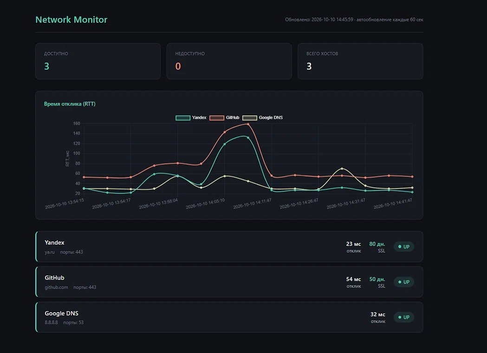
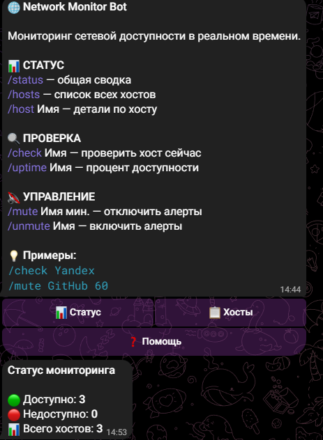

<div align="center">

# 🌐 Network Monitor

**Мониторинг сетевой доступности с Telegram-ботом, веб-дашбордом и алертами в реальном времени**

[](https://www.python.org/)
[](https://flask.palletsprojects.com/)
[](https://core.telegram.org/bots/api)
[](LICENSE)

[Возможности](#-возможности) · [Установка](#-установка) · [Запуск](#-запуск) · [Команды бота](#-команды-telegram-бота) · [Скриншоты](#-скриншоты)

</div>

---

## 📖 О проекте

**Network Monitor** — система мониторинга сетевой доступности, которая проверяет хосты через ICMP ping и TCP-порты, следит за сроком действия SSL-сертификатов и отправляет алерты в Telegram.

Управление — через **Telegram-бота** и **веб-дашборд** с графиком RTT.

Проект создан как pet-проект для демонстрации навыков системного администрирования и Python-разработки.

---

## ✨ Возможности

<table>
<tr>
<td width="50%">

### 🔍 Проверки
- **ICMP ping** — доступность хоста
- **TCP-порты** — открыты ли нужные порты
- **SSL-сертификаты** — срок действия
- **RTT** — время отклика в мс

</td>
<td width="50%">

### 🤖 Управление
- **Telegram-бот** с 8 командами
- **Inline-кнопки** в `/start`
- **Веб-дашборд** с графиком
- **Автозапуск** через Планировщик

</td>
</tr>
<tr>
<td>

### 🛡️ Умные алерты
- **State tracking** — без спама
- Алерт только при смене состояния
- Уведомления об истечении SSL
- **Maintenance window** (`/mute`)

</td>
<td>

### 🔐 Безопасность
- Токены в `.env`
- `.gitignore` настроен
- Никаких секретов в коде
- Логирование в файл

</td>
</tr>
</table>

---

## 🛠 Стек технологий

<div align="center">

| Компонент | Технология |
|:---------:|:----------:|
| **Язык** |  |
| **Backend** |  |
| **Бот** |  |
| **Графики** |  |
| **Конфиг** |  |

</div>

---

## 📦 Установка

### 1. Клонировать репозиторий

```bash
git clone https://github.com/iqowpeeee/net-monitor.git
cd net-monitor
```

### 2. Установить зависимости

```bash
pip install -r requirements.txt
```

### 3. Создать `.env`

```env
TELEGRAM_TOKEN=твой_токен_бота
TELEGRAM_CHAT_ID=твой_chat_id
```

> 💡 **Как получить токен:** [@BotFather](https://t.me/BotFather) → `/newbot`
> **Как узнать chat_id:** `https://api.telegram.org/bot<ТОКЕН>/getUpdates` после сообщения боту

---

## ⚙️ Конфигурация

Все хосты задаются в `hosts.yaml`:

```yaml
hosts:
  - name: Yandex
    address: ya.ru
    ports: [443]
    check_ssl: true
  - name: GitHub
    address: github.com
    ports: [443]
    check_ssl: true
  - name: Google DNS
    address: 8.8.8.8
    ports: [53]
    check_ssl: false
```

| Поле | Обяз. | Описание |
|:-----|:-----:|:---------|
| `name` | ✅ | Имя хоста для алертов и команд |
| `address` | ✅ | Домен или IP-адрес |
| `ports` | ➖ | Список TCP-портов |
| `check_ssl` | ➖ | Проверять срок SSL-сертификата |

---

## 🚀 Запуск

<table>
<tr>
<th>Компонент</th>
<th>Команда</th>
<th>Что делает</th>
</tr>
<tr>
<td>🔍 <b>Мониторинг</b></td>
<td><code>python monitor.py</code></td>
<td>Проверяет хосты и шлёт алерты</td>
</tr>
<tr>
<td>📊 <b>Дашборд</b></td>
<td><code>python dashboard.py</code></td>
<td>Веб-интерфейс на <a href="http://127.0.0.1:5000">localhost:5000</a></td>
</tr>
<tr>
<td>🤖 <b>Бот</b></td>
<td><code>python bot.py</code></td>
<td>Telegram-бот для управления</td>
</tr>
</table>

> ⚠️ Бот и мониторинг — **разные процессы**. Запускай их в отдельных терминалах.

---

## 🤖 Команды Telegram-бота

| Команда | Описание |
|:--------|:---------|
| `/start` | 🌐 Приветствие и меню с inline-кнопками |
| `/status` | 📊 Общая сводка (UP / DOWN / всего) |
| `/hosts` | 📋 Список всех хостов со статусами |
| `/host <имя>` | 🔍 Детали по хосту (RTT, SSL, время) |
| `/check <имя>` | ⚡ Проверить хост прямо сейчас |
| `/uptime <имя>` | 📈 Uptime и средний RTT |
| `/mute <имя> <мин>` | 🔇 Отключить алерты на N минут |
| `/unmute <имя>` | 🔔 Включить алерты обратно |

### Примеры

```bash
/check Yandex
/uptime GitHub
/mute GitHub 60
```

### Inline-кнопки в `/start`

```
[ 📊 Статус ]  [ 📋 Хосты ]
[      ❓ Помощь      ]
```

---

## 🧠 Как это работает

### State tracking

Скрипт помнит состояние хостов между запусками в `state.json`:

| Было | Стало | Действие |
|:----:|:-----:|:---------|
| 🟢 UP | 🔴 DOWN | Алерт «упал» |
| 🔴 DOWN | 🔴 DOWN | Тишина (без спама) |
| 🔴 DOWN | 🟢 UP | Алерт «восстановлен» |

**Защита от лавины одинаковых алертов.**

### Maintenance window

```
/mute GitHub 60
```

Записывает хост в `mutes.json` со временем «до». Пока текущее время меньше — алерты по хосту **не отправляются**.

Полезно во время плановых работ.

### SSL-проверка

Для хостов с `check_ssl: true` скрипт читает срок действия сертификата. Если меньше **30 дней** — приходит алерт.

---

## 🔄 Автозапуск

`net-monitor.bat` запускается через **Планировщик заданий Windows** каждые 5 минут.

1. Открыть `taskschd.msc`
2. Создать простую задачу → **Ежедневно**
3. Повтор: **каждые 5 минут**, неограниченно долго
4. Действие: `net-monitor.bat`
5. ✅ **Выполнять задачу, если пропущен плановый запуск**

---

## 📁 Структура проекта

```
net-monitor/
├── 🤖 bot.py                # Telegram-бот
├── 📊 dashboard.py          # Flask-сервер
├── 🔍 monitor.py            # Скрипт мониторинга
├── 🪟 net-monitor.bat       # Для Планировщика Windows
├── 📝 hosts.yaml            # Конфигурация хостов
├── templates/
│   └── index.html           # HTML-шаблон дашборда
├── 🔐 .env                  # Токены (не в Git)
├── 🚫 .gitignore
├── 📖 README.md
└── 📦 requirements.txt
```

---

## 📸 Скриншоты

### 📊 Веб-дашборд



### 🤖 Telegram-бот



---

## 🔐 Безопасность

- 🔒 Токен бота в `.env`, **не попадает в репозиторий**
- 🚫 `state.json`, `history.json`, `mutes.json`, логи — в `.gitignore`
- ✅ Никаких секретов в коде

---

## 📄 Лицензия

MIT — используй свободно.

---

<div align="center">

**Сделано с ❤️ для практики системного администрирования**

⭐ Поставь звёздочку, если проект был полезен!

</div>